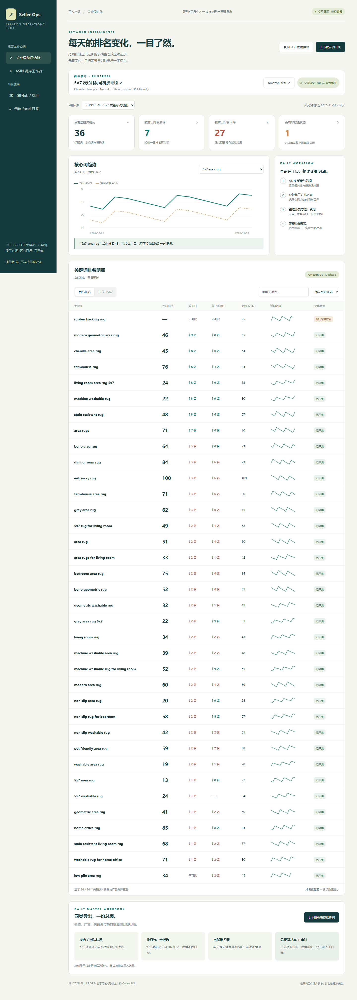
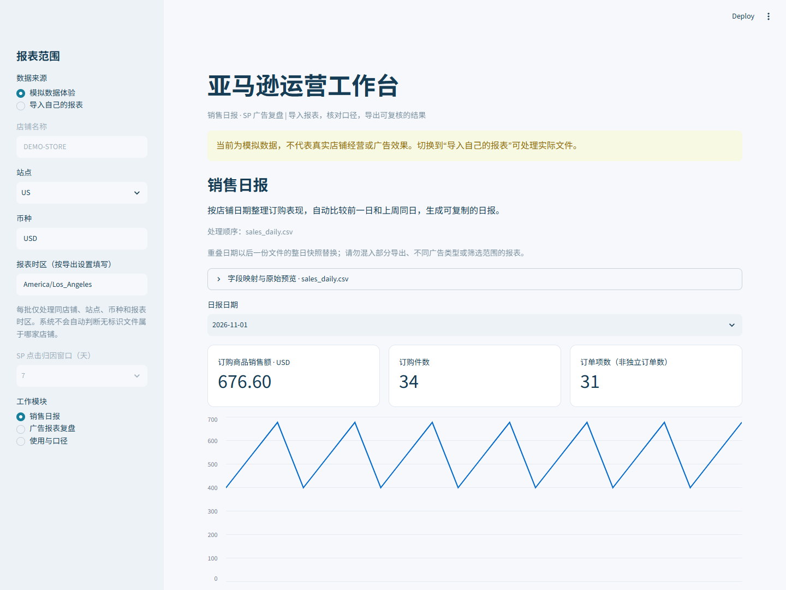
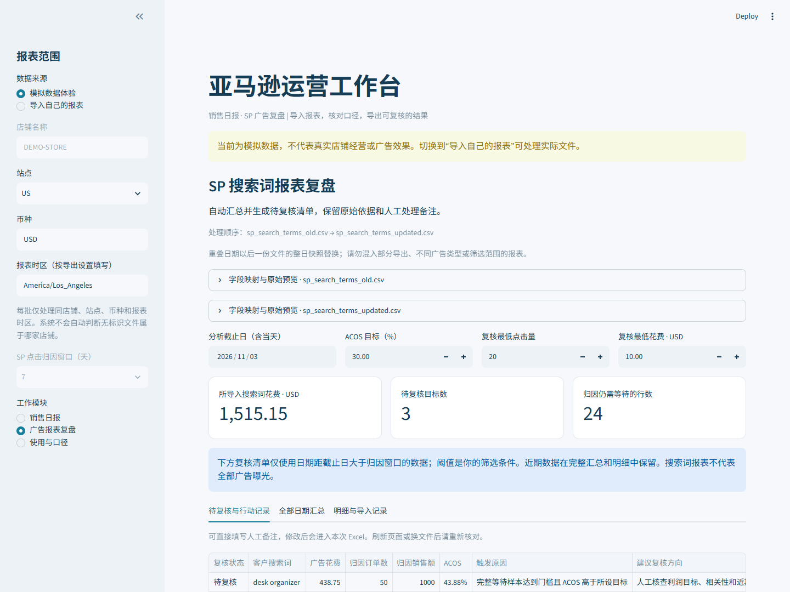

# Amazon Seller Ops · 亚马逊运营 Skill

[在线交互展示](https://l-sd.github.io/amazon-seller-ops/) · [Skill 入口](.agents/skills/amazon-seller-ops/SKILL.md) · [排名表样例](docs/keyword-ranks-demo.xlsx) · [总表模拟样例](docs/master-demo.xlsx)



以 Codex Skill 为主的亚马逊卖家运营助手：整理第三方网站返回的关键词排名表，维护逐日历史和运营总表，并支持销售日报、SP 复盘、竞品研究及选品评估。关键词展示参考公开的 RUGSREAL 5×7 可洗地毯商品页，扩展 36 个标题词、卖点词和场景词；排名走势为模拟数据。

## 真实日常工作怎么接入

网站/后台导出 → 核对字段与采集时间 → 按父子 ASIN 和日期整理 → 自然排名按关键词匹配 → 更新总表副本 → 回读及审计。

- **关键词日报**：将多个日期的第三方排名表与历史合并，分自然/SP 广告位，比较前一自然日和上周同日。缺失不填 0，重复导出不重复累计；工具或采样范围不同则分序列。
- **运营总表**：按现有模板的日期行和关键词表头写值，保护公式、历史、人工日志及 WPS/VML 等附属内容。同日冲突阻止覆盖。业务会话和广告点击分别记录，不据此推算自然流量。
- **可读 Excel**：冻结关键词列、筛选、交替底色、改善/下降颜色、百分比和金额格式；已有用户模板保留原版式。模拟样例不含用户原始总表。
- **资料边界**：排名由其他网站查询；本项目整理返回表格，不自动查询排名、不配置网站凭据、不建立定时任务。首次使用实际导出格式仍需核对并映射。

[关键词维护流程](.agents/skills/amazon-seller-ops/references/keyword-workflow.md) · [总表维护流程](.agents/skills/amazon-seller-ops/references/master-workbook.md) · [可复用日常任务](.agents/skills/amazon-seller-ops/references/routine-tasks.md)

不连接店铺、不需要 API Key、不执行广告修改。样例均为程序生成的模拟数据，不能作为真实运营成果。上传报表由本机 Python 进程处理，不发送到第三方 AI 服务。

## 在 Codex 中使用（推荐）

在 Codex 中打开本项目文件夹 `amazon-operations-workbench`，项目 Skill 位于 [.agents/skills/amazon-seller-ops/SKILL.md](.agents/skills/amazon-seller-ops/SKILL.md)。新聊天可识别项目 Skill；若当前会话未刷新技能列表，直接让 Codex 读取该文件后执行，不需要改全局配置。

可以这样提出任务：

```text
请使用 $amazon-seller-ops，分析我提供的销售和 SP 搜索词报表，生成日报及待复核清单。没有资料的账户健康和库存不要判正常。

请使用 $amazon-seller-ops，对比这几个美国站商品链接，先确认具体变体和规格，整理价格、买家问题和页面差异，附来源与观察时间。

请使用 $amazon-seller-ops，评估这些选品候选。先列需求、竞争、供应和成本证据，缺采购价和费用时不要给确定利润率。
```

工作流参考 Amazon 官方资料、Helium 10/Jungle Scout 的操作方法与卖家社区个体经验，并结合用户本地教材。[来源与适用边界](.agents/skills/amazon-seller-ops/references/sources.md)区分官方规则、工具方法和个体经验。教材原文件与个人学习记录不随仓库分发。

日常任务包括账户/商品状态、销售、库存、客户体验、广告和复盘；只有用户提供对应资料才可判断。竞品可用公开页面研究，缺少后台和付费工具不补造销量。选品给出待补证据与下一步评审，不自动采购或修改店铺。

报表脚本复用本仓库计算模块；竞品快照脚本只比较已提供记录，不自动抓取网页。使用入口和输入模板见 [报表工具说明](.agents/skills/amazon-seller-ops/references/report-tools.md)。完整仓库一起分发才能运行报表工具，单独复制 Skill 文件夹不包含 `operations.py`。

## 网页体验（可选）

在本项目目录用 PowerShell 运行：

```powershell
pwsh -NoLogo -NoProfile -File .\start.ps1
```

打开 <http://127.0.0.1:8521>，默认进入模拟数据体验。启动脚本复用当前电脑 `D:\venvs\ecommerce-analytics-agent` 的已有环境，未安装新依赖。

其他电脑需 Python 3.11 以上，在自选 D 盘目录创建环境后安装：

```powershell
python -m venv D:\venvs\amazon-operations-workbench
& D:\venvs\amazon-operations-workbench\Scripts\python.exe -m pip install -r requirements.txt
& D:\venvs\amazon-operations-workbench\Scripts\python.exe -m streamlit run app.py --server.address 127.0.0.1 --server.port 8521 --browser.gatherUsageStats false
```

安装前检查磁盘空间，临时目录和包缓存应指向 D 盘。上述命令在本项目根目录运行。运行依赖为 pandas、openpyxl、Streamlit；测试另外使用 pytest 和 ruff。

## 日常工作流程

1. 从后台导出对应报表，确认店铺、站点、币种、时区、日期粒度和广告归因窗口。
2. 选择“导入自己的报表”，填写范围并上传 CSV/TSV/XLSX。单文件最多 20 MB；XLSX 仅接受一张数据表。
3. 检查原始预览和字段映射，按由旧到新排列文件。每个日期必须是相同筛选范围的完整快照。
4. 选择日报日期，或设置广告分析截止日与复核条件。
5. 下载 Excel。销售另提供中文日报文案；广告页可填写人工备注，随本次 Excel 导出，刷新后不持久保存。

## 销售日报

输入为 Seller Central Business Reports 按日期销售与流量表，或映射到相同口径的表。

| 字段 | 要求 | 英文表头示例 |
|---|---|---|
| 日期 | 必填，一天一行 | Date |
| 订购商品销售额 | 必填 | Ordered Product Sales |
| 订购件数 | 必填 | Units Ordered |
| 订单项数 | 必填，不能用独立订单数替代 | Total Order Items |
| 会话数 | 可选，整批文件一致提供或不提供 | Sessions - Total |
| 页面浏览量 | 可选，整批文件一致提供或不提供 | Page Views - Total |

输出订购表现、销售额较前一日/上周同日变化、趋势、日报文案和导入记录。只比较对应自然日，缺日不自动填零；分母为零不计算变化率。没有会话数就不计算订购件数/会话数；该比率不是买家转化率，可能超过 100%。

不将按 ASIN 的跨日期汇总拆成日报，不读取买家身份信息，不估算净收入、利润或结算回款。订购商品销售额不是到账收入，订单项数不是独立订单数。第一版不提供 SKU 日报、跨店铺汇总或时区转换。

## SP 搜索词复盘

输入为按日 SP（Sponsored Products）客户搜索词报表，支持 7 天或 14 天点击归因。演示使用 7 天。

必填字段：Date、Campaign Name、Ad Group Name、Targeting、Match Type、Customer Search Term、Impressions、Clicks、Spend，以及相同窗口的 Total Sales 和 Total Orders。

- 自动识别部分常见中英文表头；不能识别时手动映射，不声称覆盖所有平台语言和版本。
- 7 天示例：`7 Day Total Sales`、`7 Day Total Orders (#)`；14 天选择相应窗口列。通用销售/订单列须人工确认窗口和点击归因口径。暂不支持浏览归因、混合归因或同 SKU/promoted 指标。
- 若有 End Date，必须与每行起始日期相同，跨日期汇总会阻止处理。未带起止字段的跨日期汇总，需要操作者识别并重新导出。
- CTR=点击/曝光，CPC=花费/点击，ACOS=花费/归因销售额，ROAS=归因销售额/花费。比率使用合计分子/合计分母，不平均行比率；零分母留空。
- 日期距所选截止日天数 **大于** 归因窗口，才进入复核样本。该标记仅说明已完整等待，不保证平台数据最终确认。**截止日须与实际导出时间相符，不能用今天的日期让旧快照假装已经更新。**
- 全部日期汇总保留近期数据，复核清单仅用完整等待日期。默认点击门槛 20、花费门槛 10、目标 ACOS 30% 都是可调整的演示参数，不是统一运营标准。
- 搜索词报表仅覆盖至少一次点击的搜索词或商品目标，不能代表全部广告曝光。不会与销售额相减推断自然销售，也不输出 TACOS。
- 业务键为活动名、广告组名、投放目标、匹配类型、客户搜索词；同名不同实体需分批处理。第一版不使用活动 ID 追踪跨名称变更。

## 合并规则与质量检查

文件内完全重复行去重并记录；相同业务键出现不同数值会报错，不擅自累加。

文件由旧到新：后一个文件替换已有日期的整个快照，包括移除旧快照中已消失的搜索词。**部分活动导出、不同筛选范围不可混合覆盖。** 没有任何数据行的日期无法据此判为零或清除旧快照，应重新导出完整范围并单独分析。

导出记录包含顺序、原始行数、重复行数、覆盖行数、字段映射与 SHA256，便于追溯。原文件不被改写。

原表若提供 Store/Marketplace/Currency/Timezone，会与所选范围核对；无标识文件的归属无法自动判断，需人工确认。不同店铺、站点、币种、时区必须分批。

金额使用小数点、逗号千分位，如 `USD 1,234.56`；不支持欧洲式 `1.234,56`、负数退款表或自动换汇。空白数值不会当成零。日期支持 YYYY-MM-DD、YYYY/MM/DD 和美式 MM/DD/YYYY；其他地区日期先在副本上转为 ISO 格式。

## 项目结构与 GitHub 发布

- `app.py`：本地操作页面。
- `operations.py`：导入、校验、指标与 Excel 导出。
- `examples/`：三份模拟 CSV，包含广告重叠日期与归因更新示例。
- `generate_examples.py`：重建模拟样例。
- `tests/`：快照覆盖、指标、异常、Excel 与界面流程测试。
- `verify_browser.py`：浏览器上传/下载验收，需已有 Playwright 与 Chrome；不是应用运行依赖。
- `docs/`：实际界面截图。

真实报表放 `private_data/`，下载结果放 `outputs/`，均已加入忽略规则。发布前仍须检查待提交文件，不上传公司数据。本项目尚未使用真实公司报表验收，不能宣称已取得实际业务收益。AI 辅助开发的分工应在简历和面试中如实说明。

## 验证命令

```powershell
python generate_examples.py
python build_showcase.py
python -m pytest
python -m ruff check . .agents/skills/amazon-seller-ops/scripts
```

## 官方资料

查阅日期：2026-11-03。实际账号的导出列名、语言和权限可能不同；资料用于确认指标与报表边界。

- [Business Reports 指标](https://sellercentral.amazon.com/help/hub/reference/external/202142060)
- [SP 搜索词报表](https://advertising.amazon.com/help/G3HEFZYWZF84NPS9)
- [广告归因说明](https://advertising.amazon.com/help/GX7KDKHMWQYMJ385)

## 实际界面

在线静态页面只展示模拟数据，可搜索关键词、切换 ASIN、区分自然与 SP 排名，并下载模拟 Excel。Streamlit 上传界面需本地运行，不能在 GitHub Pages 执行 Python。




